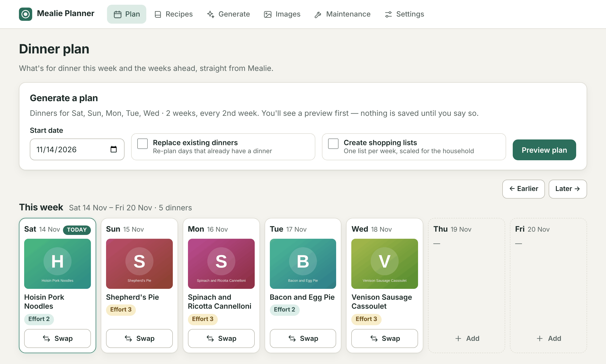
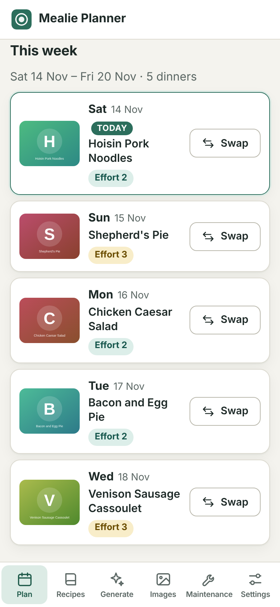

# Mealie Planner

A small web app that plans family dinners in your [Mealie](https://mealie.io) instance. It picks dinners from your Mealie recipe library, keeps busy weeknights easy, builds the shopping lists, and can ask Claude for new recipes when the library gets stale.

It runs as one Docker container next to Mealie. Everything it plans is stored in Mealie itself; the app only keeps its own settings and job history.



> Screenshots in this README and the how-tos were taken against the bundled fake Mealie (`dev/fake_mealie.py`), so recipe photos are coloured placeholders.

## Contents

- [Features](#features)
- [Quick start with Docker Compose](#quick-start-with-docker-compose)
- [Running on TrueNAS](#running-on-truenas)
- [Where the image comes from](#where-the-image-comes-from)
- [Updating](#updating)
- [How-tos](#how-tos)
- [How planning works](#how-planning-works)
- [The CLI](#the-cli)
- [Development](#development)
- [Troubleshooting and notes](#troubleshooting-and-notes)
- [What has and has not been tested](#what-has-and-has-not-been-tested)
- [Changelog](CHANGELOG.md)

## Features

| Page | What you do there |
|---|---|
| **Plan** | See four weeks of dinners. Generate a plan, preview it, re-roll or hand-pick any day, then save it to Mealie with optional shopping lists. Swap or add a dinner on any day later. |
| **Recipes** | Mark which recipes are dinners and rate each one for effort, 1 (very quick) to 5 (time-intensive). Changes save as you click. |
| **Generate** | Ask Claude for a batch of new dinner recipes, review them, and import the ones you tick. Or import recipes from web addresses with Mealie's own scraper. |
| **Images** | Search the web (DuckDuckGo) for a better cover photo for a recipe, or paste an image address. |
| **Maintenance** | Parse every recipe's ingredients into amount, unit and food so shopping lists can combine and scale them. See the history of background jobs. |
| **Settings** | Household size, which days to plan, effort limits per weekday, pantry staples, the Claude model and prompt. Also shows whether the app can reach Mealie. |

Other things worth knowing:

- Nothing is written to Mealie until you press **Save to Mealie** on a plan preview, or **Import** on a batch of recipes.
- Long jobs (generating, importing, parsing) run in the background. You can leave the page and come back.
- An optional single password (`APP_PASSWORD`) puts a login in front of every page.
- It works on a phone:



## Quick start with Docker Compose

You need Docker, a running Mealie, and a Mealie API token. An Anthropic API key is only needed for generating recipes.

1. Make a folder for the app and create the data folder yourself. If you let Docker create it, it is owned by root and the app cannot write to it. By default the container runs as user and group id `568`, so give the folder to that id:

   ```bash
   mkdir -p mealie-planner/data && cd mealie-planner
   sudo chown 568:568 data
   ```

   If you would rather run the app as your own user, skip the `chown` and add `PUID` and `PGID` to `.env` in step 3 (the output of `id -u` and `id -g`).

2. Save this as `docker-compose.yml` (it is the same file as the one in this repository):

   ```yaml
   services:
     mealie-planner:
       # Pull the published image, or swap this line for `build: .` to build locally.
       image: ghcr.io/paulcavill/mealie_planning:latest
       container_name: mealie-planner
       restart: unless-stopped
       # The user the app runs as. It must be able to write the folder mounted at
       # /data below, or the app reports "data folder cannot be written" and
       # /healthz turns unhealthy. 568:568 is TrueNAS's built-in `apps` user: give
       # the dataset to it. On an ordinary Linux host either `chown 568:568 ./data`
       # or set PUID / PGID in .env to your own `id -u` / `id -g`.
       user: "${PUID:-568}:${PGID:-568}"
       ports:
         - "8080:8080"
       environment:
         MEALIE_BASE_URL: ${MEALIE_BASE_URL}        # e.g. http://mealie:9000
         MEALIE_TOKEN: ${MEALIE_TOKEN}              # Mealie > Profile > API Tokens
         ANTHROPIC_API_KEY: ${ANTHROPIC_API_KEY:-}  # only needed for recipe generation
         APP_PASSWORD: ${APP_PASSWORD:-}            # optional: set to require a login
      ALLOWED_HOSTS: ${ALLOWED_HOSTS:-}          # optional: domain names the app may be opened by
         TZ: ${TZ:-Pacific/Auckland}
       volumes:
         # Settings, plan previews and job history. Create the folder yourself
         # first (Docker would create it owned by root, which the app can't write)
         # and make it writable by the user above. On TrueNAS, point this at a
         # dataset, e.g. /mnt/tank/apps/mealie-planner:/data
         - ./data:/data
   ```

3. Next to it, create a `.env` file with your values:

   ```ini
   MEALIE_BASE_URL=http://192.168.1.10:9000
   MEALIE_TOKEN=your_long_lived_api_token
   ANTHROPIC_API_KEY=sk-ant-...
   APP_PASSWORD=choose-something
   TZ=Pacific/Auckland
   ```

4. Start it and open `http://<your-server>:8080`:

   ```bash
   docker compose up -d
   ```

5. Open **Settings**. The **Connection** card at the top should say `Connected` next to Mealie. If the app could not find `MEALIE_BASE_URL` or `MEALIE_TOKEN` it shows a set-up page instead of the plan.

> The published image only exists once this work is merged to `main` (see [Where the image comes from](#where-the-image-comes-from)). Until then, clone the repository, replace the `image:` line in `docker-compose.yml` with `build: .`, and run `docker compose up -d --build`.

### Environment variables

| Variable | Required | What it is |
|---|---|---|
| `MEALIE_BASE_URL` | Yes | The address of Mealie **as the container can reach it**, for example `http://192.168.1.10:9000`. A Docker service name such as `http://mealie:9000` only works if both containers are on the same Docker network. |
| `MEALIE_TOKEN` | Yes | A Mealie API token. |
| `ANTHROPIC_API_KEY` | No | Needed only for **Generate → New dinner ideas** (and the CLI `suggest` command). Without it that form is switched off; everything else works. |
| `APP_PASSWORD` | No | If set, every page needs this password. If empty, anyone who can reach port 8080 can use the app. |
| `PUID`, `PGID` | No | Read by the compose file, not by the app: the user and group id the container runs as. Default `568:568`. That user must be able to write the folder mounted at `/data`. |
| `TZ` | No | Time zone, used to decide what "today" is. The compose file defaults it to `Pacific/Auckland`. |
| `DATA_DIR` | No | Where the app keeps its SQLite file, `planner.db`. The image sets it to `/data`; leave it alone and mount a volume at `/data`. Outside Docker it defaults to the `data` folder next to the code, wherever you run it from. |
| `ALLOWED_HOSTS` | No | Only matters when `APP_PASSWORD` is empty. Extra names the app may be opened by, comma separated, for example `planner.example.com`. IP addresses, single-word names such as `truenas`, and names ending in `.local`, `.lan`, `.home`, `.internal` or `.home.arpa` always work. `*` allows any name. |
| `MEALIE_TIMEOUT` | No | Seconds to wait for Mealie to answer. Default `60`. Not in the compose file; add it under `environment:` if you need it. |
| `MEALIE_USERNAME`, `MEALIE_PASSWORD` | No | Used to sign in to Mealie only when `MEALIE_TOKEN` is not set. A token is the better choice. Not in the compose file. |

**Getting a Mealie API token:** in Mealie, open your user profile, choose **API Tokens**, and create one. Copy it straight away; Mealie shows it once.

**Getting an Anthropic API key:** sign in at [console.anthropic.com](https://console.anthropic.com), create an API key, and add some credit. Generating recipes is billed per use by Anthropic. The model is set in **Settings** (default `claude-haiku-4-5-20251001`).

### What is in the `/data` volume

One file, `planner.db`: your settings, unsaved plan previews, the background job history and the secret that signs login cookies. Your recipes, meal plans and shopping lists are in Mealie, not here. If you lose the volume you lose your settings, nothing else.

### The login

- `APP_PASSWORD` is a single shared password, not user accounts. A login lasts 30 days, and changing the password logs everyone out.
- The app serves plain HTTP. If you expose it beyond your home network, put it behind a reverse proxy with HTTPS.
- With no password set, the app only answers when it is opened by an IP address or a local name (see `ALLOWED_HOSTS` above). This stops a website from reaching the app by pointing its own domain at your NAS. If you open the app by a full domain name, set `APP_PASSWORD` or add the name to `ALLOWED_HOSTS`.
- The app refuses form posts that a browser says came from another site, whether or not a login is set. A reverse proxy must pass the original `Host` header, or set `X-Forwarded-Host`, or every button will be refused.

## Running on TrueNAS

**This has not been tested on a real TrueNAS system.** The steps below are how a plain Compose app is installed on TrueNAS SCALE 24.10 ("Electric Eel") or later. There is no catalog app for Mealie Planner; you install it as a custom app from YAML.

1. Create a dataset for the app's data, for example `tank/apps/mealie-planner`. The container runs as user and group id `568`, which is TrueNAS's built-in `apps` user. Make the dataset writable by `apps` (set `apps` as the owner, or use the **Apps** ACL preset). If it is not writable, the app shows a "can't save anything" page that says so.

2. Go to **Apps → Discover Apps → Custom App** and choose **Install via YAML**. (On some versions **Install via YAML** is in the ⋮ menu beside the **Custom App** button.)

3. Give the app a name such as `mealie-planner` and paste this, with your own values. TrueNAS has no `.env` file to read, so the values go straight into the YAML:

   ```yaml
   services:
     mealie-planner:
       image: ghcr.io/paulcavill/mealie_planning:latest
       restart: unless-stopped
       user: "568:568"                               # TrueNAS's `apps` user
       ports:
         - "8080:8080"
       environment:
         MEALIE_BASE_URL: http://192.168.1.10:9000   # your NAS address and Mealie's port
         MEALIE_TOKEN: your_long_lived_api_token
         ANTHROPIC_API_KEY: sk-ant-...               # or leave this line out
         APP_PASSWORD: choose-something              # or leave this line out
         TZ: Pacific/Auckland
       volumes:
         - /mnt/tank/apps/mealie-planner:/data
   ```

4. Save. When the app shows as running, open `http://<nas-address>:8080`.

Notes for TrueNAS:

- If port `8080` is already used by another app, change the left-hand number, for example `"8085:8080"`.
- Each TrueNAS app gets its own Docker network. If Mealie is another app on the same NAS, use the NAS's IP address and Mealie's published port in `MEALIE_BASE_URL`, not `http://mealie:9000`.
- If the image is private, TrueNAS has to sign in to `ghcr.io` before it can pull it. See the next section.

## Where the image comes from

`.github/workflows/docker-publish.yml` runs the tests, builds the image and pushes it to the GitHub Container Registry (GHCR) as `ghcr.io/paulcavill/mealie_planning`.

| When | Tags pushed |
|---|---|
| A push to `main` | `latest` and `sha-<short commit>` |
| A tag such as `v2.0.0` | `2.0.0` and `sha-<short commit>` |
| A manual run of the workflow | `sha-<short commit>` (plus `latest` if run on `main`) |

Things to know:

- **The image does not exist until this branch is merged to `main`** and the workflow has run once. Until then use `build: .` in the compose file, from a clone of the repository.
- If the repository or the GHCR package is private, the machine pulling the image has to log in first: `docker login ghcr.io` with your GitHub username and a personal access token that has the `read:packages` scope. On TrueNAS, add the registry sign-in in the Apps settings. Alternatively make the package public in its GitHub package settings.
- The workflow builds for `linux/amd64` and `linux/arm64`.

## Updating

With the published image:

```bash
docker compose pull
docker compose up -d
```

With a local build:

```bash
git pull
docker compose up -d --build
```

On TrueNAS, pull the new image from the app's menu on the **Installed** apps screen, or edit and save the app so it redeploys. Settings live in the `/data` volume and survive an update.

## How-tos

Short, screenshot-led walkthroughs:

| How-to | Covers |
|---|---|
| [Plan a fortnight](docs/howto/plan-a-fortnight.md) | Generate a plan, adjust it, save it with shopping lists, swap a day later |
| [Add new recipes](docs/howto/add-new-recipes.md) | Generate recipes with Claude, review and import them; import from a web address |
| [Tidy your recipe library](docs/howto/tidy-your-recipe-library.md) | Mark dinners, rate effort, fix a cover image, parse ingredients |
| [Change the rules](docs/howto/change-the-rules.md) | Household size, planned days, effort limits, pantry staples, the Claude model and prompt |

## How planning works

Only recipes tagged `dinner` in Mealie are ever planned. Effort ratings are Mealie tags too: `effort-1` to `effort-5`. The **Recipes** page sets both.

Every rule below is a setting. The defaults reproduce the original household's routine; change them on the **Settings** page and they apply to the next plan.

| Rule | Default | Setting on the Settings page |
|---|---|---|
| Days that get a dinner | Saturday, Sunday, Monday, Tuesday, Wednesday | **Plan dinners on** |
| Week starts on | Saturday | **Week starts on** |
| Weeks filled by one plan | 2 | **Weeks per plan** |
| Gap between those weeks | Every 2nd week (so a plan made on the 14th fills the weeks of the 14th and the 28th) | **Plan every Nth week** |
| Effort limit | Monday and Wednesday: effort 3 or less. Other days: no limit | **Effort limit per weekday** |
| No repeats within | 40 days | **Don't repeat within (days)** |
| Household | 3 adults + 1 child, a child counting as 0.5 of a serving = 3.5 servings | **Adults**, **Children**, **Child portion** |
| Servings assumed when a recipe has none | 4 | **Default servings** |
| Swap hides recipes planned in the next | 6 weeks | **Swap looks ahead (weeks)** |
| Pantry staples | Salt, pepper, garlic, lemon, onion, common cooking oils, skewers (20 names) | **Pantry staples** |

How a plan is put together:

1. **Start date.** The form suggests the next week-start day (today counts). You can pick any date; a plan that starts on another weekday still only fills the configured weekdays, within the seven days from the start date, and shows a warning.
2. **Days that already have a dinner are kept.** They are shown as "Already planned · kept" and their recipes are not proposed again elsewhere in the same plan. Tick **Replace existing dinners** to re-plan them instead; the preview lists what will be deleted.
3. **Picking a recipe.** For each empty day the planner picks at random from dinner recipes that are not already in this plan and were not eaten in the lookback period. If that leaves nothing, it allows repeats and says so in a warning.
4. **Effort limit.** On a limited weekday only recipes at or below the limit are picked. Unrated recipes are allowed. If nothing fits, the limit is waived for that day with a warning.
5. **Saving.** Before writing, the app re-reads the plan from Mealie. A day that gained a dinner since the preview is left alone and reported. When a dinner is being replaced, the new one is added first and the old one removed afterwards. If Mealie refuses a dinner, the rest are still saved and the page says which one failed.
6. **Scaling.** Each recipe gets a scale factor: household servings ÷ recipe servings, rounded to two decimals (3.5 ÷ 4 = 0.88). It is applied to shopping-list quantities. The meal plan entry itself is not scaled.
7. **Shopping lists.** With **Create shopping lists** ticked, each week gets a Mealie list named `Week of 14 Nov 2026` (the week's start date). A list with that name is deleted and rebuilt, which loses anything ticked off or added to it by hand; the preview warns you when that is about to happen. Kept dinners are included at the household scale. Items whose food name exactly matches a pantry staple are then removed.

## The CLI

The original command-line tool still works and uses the same logic and the same settings as the web app.

Inside the running container:

```bash
docker exec -it mealie-planner python main.py week
docker exec -it mealie-planner python main.py plan --dry-run
```

Outside Docker, from a clone with dependencies installed (`pip install -r requirements.txt`) and a `.env` file (copy `.env.example`):

```bash
python main.py <command> [options]
```

| Command | What it does |
|---|---|
| `plan [--start YYYY-MM-DD] [--shopping-list] [--override-plan] [--dry-run]` | Plan the configured weeks and write them to Mealie. `--dry-run` prints the plan and writes nothing. `--override-plan` replaces dinners already on the planned dates. |
| `week [DAYS]` | Show this Monday–Sunday week, or the next `DAYS` days starting today. |
| `replace DATE [--search TEXT] [--effort N]` | Pick a different dinner for a date that already has one, from a numbered list. |
| `suggest [--count N] [--restrict "TEXT"] [--dry-run]` | Generate recipes with Claude and import them. `--dry-run` lists them without importing. |
| `scrape URL` or `scrape --file urls.txt` `[--dry-run]` | Import recipes with Mealie's URL scraper. |
| `recipes` | List every recipe with its servings and slug. |
| `tag-dinners` | Step through recipes and mark dinners (`y`/`n`/`q`). |
| `tag-effort` | Step through recipes and rate effort (`1`–`5`, `s` to skip, `q` to quit). |
| `parse-ingredients` | Parse the ingredients of every recipe. |
| `replace-image [--search TEXT] [--url IMAGE_URL]` | Replace cover images from a web search, or from one image address. |

The CLI has no command for editing settings; use the **Settings** page. It reads them from `$DATA_DIR/planner.db`, so inside the container it sees exactly what the web app sees.

## Development

You do not need a real Mealie. `dev/fake_mealie.py` is an in-memory imitation with 56 seeded recipes, a meal plan and a shopping list. See [dev/README.md](dev/README.md) for what it does and where it differs from real Mealie.

```bash
python -m venv .venv && . .venv/bin/activate
pip install -r requirements.txt -r requirements-dev.txt

# terminal 1: the fake Mealie
python dev/fake_mealie.py --port 9925

# terminal 2: the web app, at http://127.0.0.1:8080
MEALIE_BASE_URL=http://127.0.0.1:9925 MEALIE_TOKEN=dev DATA_DIR=./data ALLOW_PRIVATE_IMAGE_HOSTS=1 \
  uvicorn web.app:app --reload --port 8080
```

- `curl -X POST http://127.0.0.1:9925/__reset` puts the fake's seed data back.
- `python dev/fake_mealie.py --port 9925 --recipes 450` seeds a large library.
- Without `ANTHROPIC_API_KEY` the generate form is disabled; everything else works against the fake.

Run the tests. They need no network: the logic tests use an in-memory stand-in, and the web tests start the fake Mealie on a local port.

```bash
pytest -q
```

### Project structure

```
Mealie_Planning/
├── web/                    # The web app (FastAPI + Jinja templates + HTMX)
│   ├── app.py              # App, login middleware, image proxy, error pages
│   ├── auth.py             # Optional password login and session cookie
│   ├── deps.py             # Configuration, Mealie client, templates, error messages
│   ├── jobs.py             # Background jobs (generate, import, scrape, parse)
│   ├── previews.py         # Plan previews stored between preview and save
│   ├── routes/             # plan, recipes, generate, images, maintenance, settings
│   ├── templates/          # One folder per page
│   └── static/             # app.css, app.js, htmx.min.js, icons
├── core/                   # The logic; returns data, never prints or prompts
│   ├── planning.py         # Preview, re-roll, save, shopping lists, swap
│   ├── recipes.py          # Listing, dinner/effort tags, ingredient parsing, URL import
│   ├── generate.py         # Claude recipe generation and import
│   ├── images.py           # Image search and upload
│   ├── settings.py         # All settings and their defaults
│   ├── db.py               # SQLite file at $DATA_DIR/planner.db
│   └── errors.py
├── mealie_client/          # Mealie REST API client
│   ├── client.py           # Auth, requests, pagination
│   ├── recipes.py          # Recipes, tags, images, ingredient parsing
│   ├── meal_plans.py
│   ├── shopping.py
│   └── foods.py            # Foods and units
├── main.py                 # The CLI
├── env_loader.py           # Minimal .env reader for local runs
├── dev/                    # Fake Mealie server and a smoke test (not in the image)
├── tests/                  # pytest suite
├── docs/                   # How-tos and screenshots
├── Dockerfile
├── docker-compose.yml
├── .github/workflows/docker-publish.yml
├── requirements.txt
└── requirements-dev.txt
```

## Troubleshooting and notes

**The app shows "Connect the planner to Mealie".** `MEALIE_BASE_URL` or `MEALIE_TOKEN` is not set in the container. Fix the environment and restart.

**"Could not reach Mealie" or "Mealie rejected the API token".** Open **Settings**; the Connection card shows the address in use and what went wrong. The address must work from inside the container, so `localhost` will not reach a Mealie on the host.

**"The planner can't save anything".** The folder mounted at `/data` is not writable by the user the container runs as. The page names the folder and the user id. `chown` the folder or dataset to that id (`568:568` by default), or set `PUID` and `PGID` to the folder's owner, then restart. While this lasts, `/healthz` answers 503 and Docker shows the container as unhealthy.

**"This app does not answer to the name ...".** You opened the app by a domain name and no password is set. Set `APP_PASSWORD`, or add the name to `ALLOWED_HOSTS`, and restart.

**"That request did not come from this app's own page".** Usually a reverse proxy that changes the `Host` header. Pass the original host through, or set `X-Forwarded-Host`.

**The planner says there are no dinner recipes.** Only recipes tagged `dinner` are planned. Mark some on the **Recipes** page. Recipes generated with Claude are tagged automatically; recipes imported from a web address are not.

**A day got a harder dinner than its limit.** Unrated recipes are allowed on limited days, and the limit is waived (with a warning in the preview) when nothing fits. Rate more recipes on the **Recipes** page.

**Shopping lists do not combine or scale ingredients.** Mealie can only do that for parsed ingredients. Run **Maintenance → Parse all ingredients**. Units and foods that do not exist in Mealie yet are created during parsing.

**A pantry staple is still on the list.** Staples are matched on the exact food name, ignoring case. "garlic" does not remove "garlic cloves"; add the name as Mealie shows it.

**An imported recipe is marked "Failed" but is in Mealie.** The recipe was created and a later step (usually ingredient parsing) failed. Retry from **Maintenance → Parse all ingredients**.

**Image search finds nothing or says it is unavailable.** The search goes through DuckDuckGo, which sometimes refuses automated requests. Try again later or paste an image address. During import, the first result that is a real image of at least 20 KB is used; if none qualifies the recipe is left without a cover.

**"Use this image" refuses an address.** Image addresses must be `http://` or `https://` on the public internet, and at most 15 MB. Addresses on your own network (`192.168.x.x`, `localhost`, the NAS itself) are refused on purpose. For development against the fake Mealie, set `ALLOW_PRIVATE_IMAGE_HOSTS=1`.

**A new cover image does not show on the Plan page straight away.** Thumbnails there are cached by the browser for up to five minutes.

Other notes:

- **Duplicates.** Importing skips any generated recipe whose name already exists in Mealie. Planning twice is safe: days that already have a dinner are kept.
- **Source links.** Claude is told to include only real source addresses, but the app does not check them. Treat them as hints.
- **Recipe times.** In the CLI era Mealie was found not to keep `prepTime`/`cookTime`/`totalTime` from imported recipe JSON, which is why effort is a rating from Claude rather than something worked out from durations. This was not re-checked for this release.
- **One job of each kind at a time.** Starting a second generate, import, URL import or parse job while one is running takes you to the running one.
- **Restarts.** A background job that was running when the container restarted is marked as failed in the history. The 60 most recent jobs are kept. Unsaved plan previews are kept for 14 days.
- **Limits.** 1–50 recipes per generate batch, 25 web addresses per URL import, and recipe pickers show the first 100 matches (search to narrow).
- **Large libraries.** All list calls page through everything in Mealie, so there is no recipe-count limit. The Recipes and Images pages fetch the whole recipe list from Mealie on each load, so they get slower as the library grows.

## What has and has not been tested

- The app, the CLI and the test suite have been run against the bundled **fake Mealie** only, not against a real Mealie instance in this release cycle. Most of the Mealie API calls are the ones the 1.0 CLI used against a real instance, but the paging through long lists and the tag removal are new and have only met the fake.
- Recipe generation was exercised in the browser with a stand-in for Claude, not with a real Anthropic API key.
- Web image search could not be reached from the development environment; the picker was exercised with stand-in results.
- The Docker image was built and run in the development environment, with one change: an extra certificate so `pip` could get through that environment's proxy. It started, passed its health check, honoured `TZ`, saved settings as uid 568, and reported unhealthy with a root-owned data folder. The `Dockerfile` exactly as committed has not been built, the image was not connected to a Mealie instance, and the GitHub workflow has not run yet.
- **Nothing has been tested on TrueNAS.**
