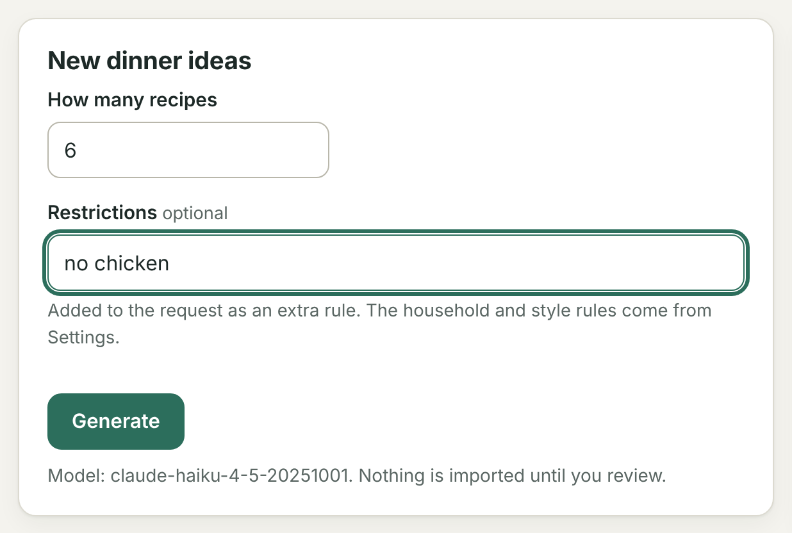
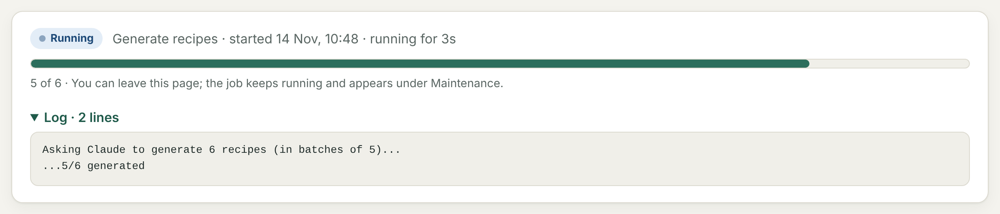
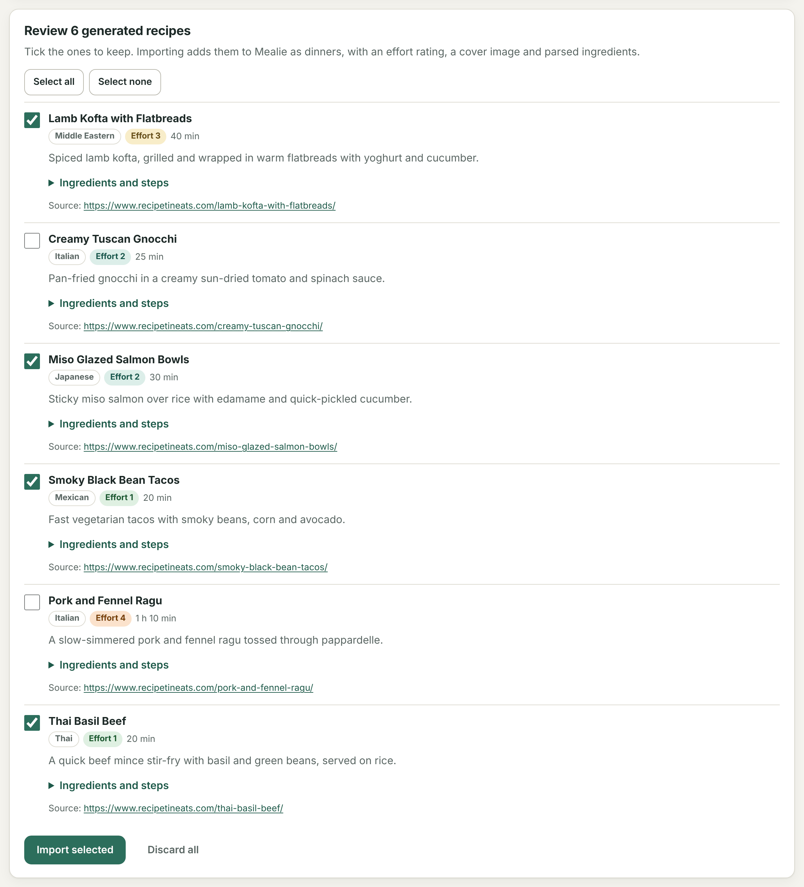
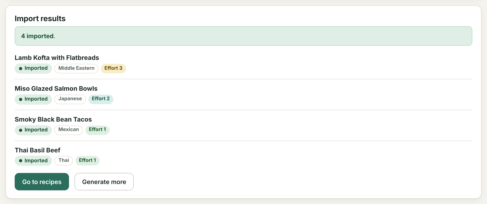
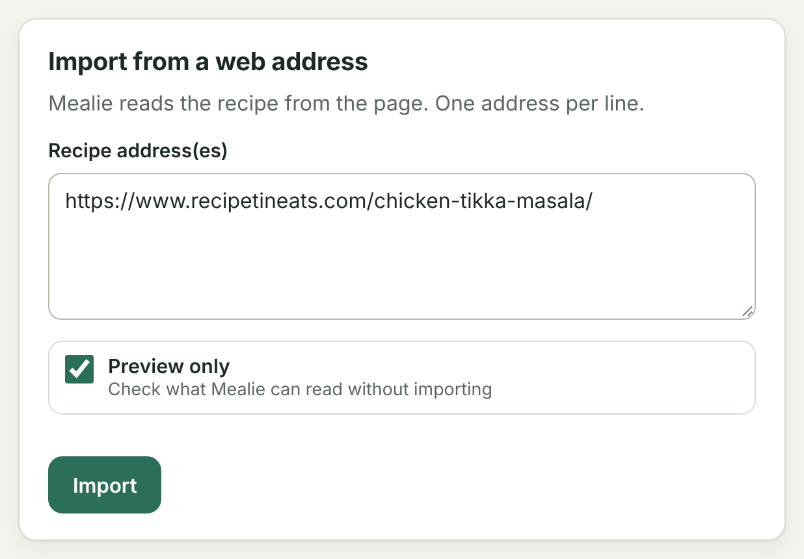
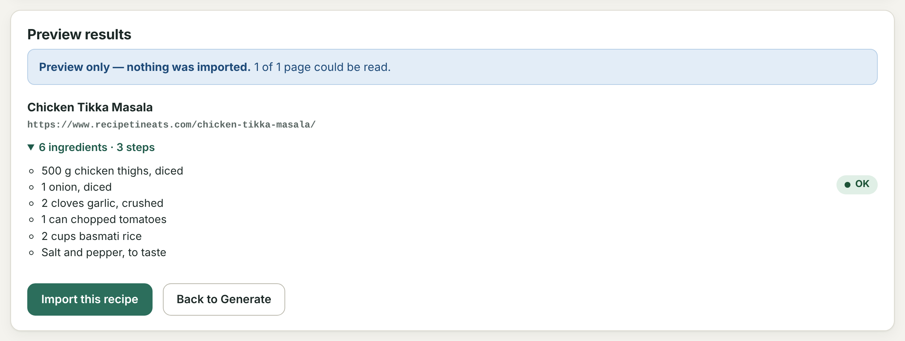
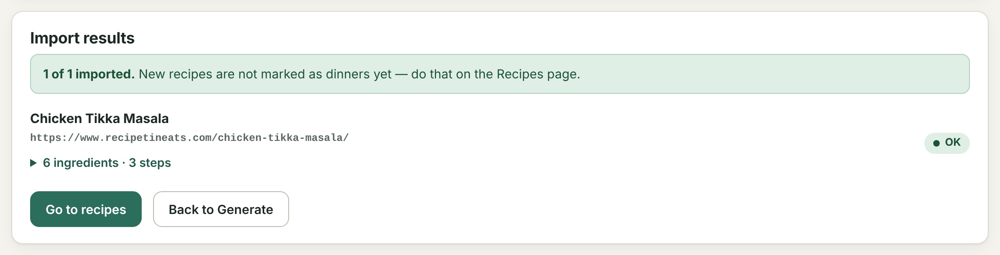

# Add new recipes

Get new dinner ideas from Claude, keep the ones you like, and import a recipe from a web address.

[Back to the README](../../README.md) · Previous: [Plan a fortnight](plan-a-fortnight.md) · Next: [Tidy your recipe library](tidy-your-recipe-library.md)

Generating needs `ANTHROPIC_API_KEY` to be set. Importing from a web address (steps 5–7) works without it.

## 1. Ask for a batch

Open **Generate**. Enter how many recipes you want (1 to 50) and, if you like, a restriction such as `no chicken` or `at least two vegetarian`. Click **Generate**.

## 2. Wait for Claude

Recipes are requested a few at a time, so the bar moves in steps. You can leave the page; the job carries on and is listed under **Recent batches** on the Generate page and in **Maintenance**.

## 3. Review and untick

Nothing has been imported yet. Untick anything you don't want, and open **Ingredients and steps** to read a recipe. Then click **Import selected**.

## 4. Check the results

Each imported recipe is tagged as a dinner, given Claude's effort rating, a cover image from a web search, and parsed ingredients. A recipe whose name is already in Mealie is skipped. The planner can use the new recipes straight away.

## 5. Import from a web address

Found a recipe online? On **Generate**, paste its address into **Import from a web address**, one per line, up to 25. Tick **Preview only** to check what Mealie can read before importing. Click **Import**.

## 6. Check the preview

Mealie's scraper reads the page. Open the ingredient list to check it looks right, then click **Import this recipe**. A page Mealie cannot read is shown as **Failed**.

## 7. Mark it as a dinner

Recipes imported from a web address are not tagged as dinners or rated, so the planner ignores them. Click **Go to recipes** and follow [Tidy your recipe library](tidy-your-recipe-library.md).
