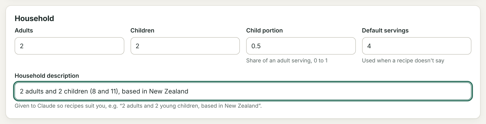
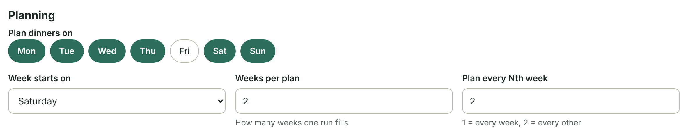
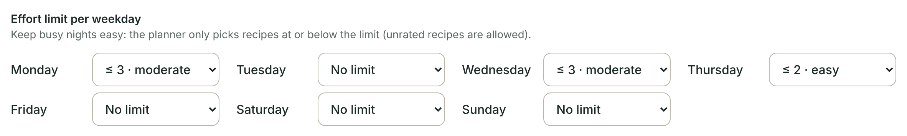
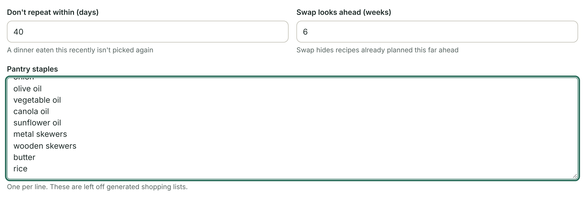
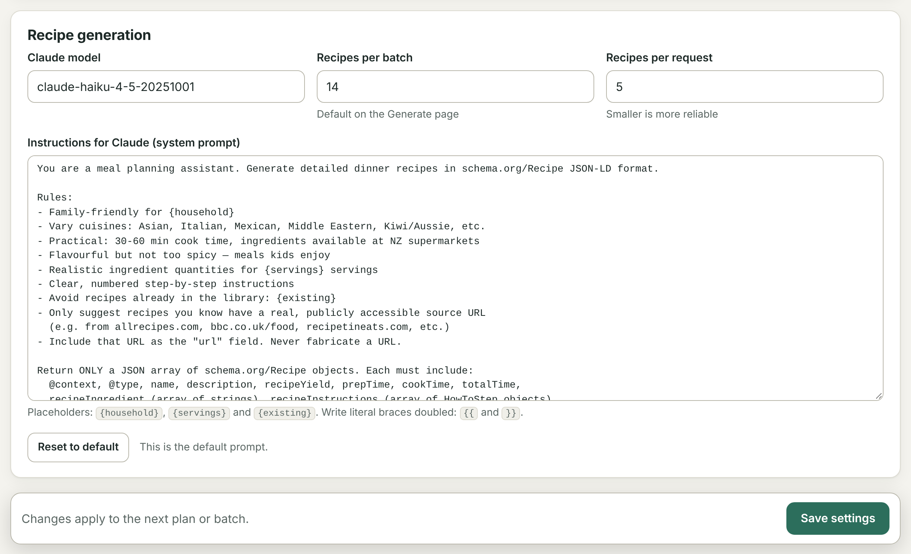
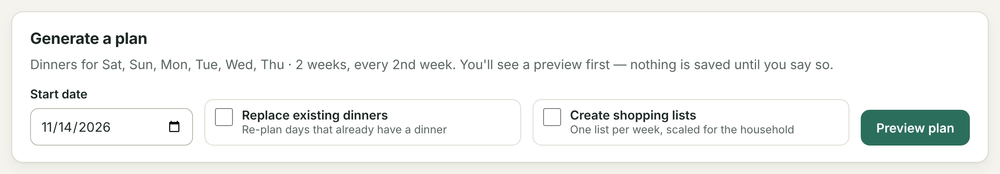

# Change the rules

Everything the planner assumes about your household is on the **Settings** page. Changes apply to the next plan or batch of recipes; plans already saved to Mealie are not touched.

[Back to the README](../../README.md) · Previous: [Tidy your recipe library](tidy-your-recipe-library.md)

## 1. Set your household

Enter the number of **Adults** and **Children**. **Child portion** is how much of an adult serving a child eats: 2 adults and 2 children at 0.5 is 3 servings. That number scales shopping-list quantities. **Household description** is passed to Claude so new recipes suit you.

## 2. Choose the days to plan

Click the weekdays that should get a dinner. **Weeks per plan** is how many weeks one click of **Preview plan** fills, and **Plan every Nth week** is the gap between them: `1` plans consecutive weeks, `2` skips every other week.

## 3. Keep busy nights easy

Pick the highest effort you will accept on each weekday. On a limited day the planner only picks recipes rated at or below the limit, plus unrated ones. If nothing fits, it picks anyway and warns you in the preview.

## 4. Set the repeat gap and pantry staples

**Don't repeat within (days)** stops a recipe coming back too soon. **Pantry staples** are things you always have: one per line, and they are removed from generated shopping lists. A staple must match the food's name in Mealie exactly, so add `garlic cloves` as well as `garlic` if Mealie uses both.

## 5. Adjust what Claude is told, then save

**Claude model** is the Anthropic model name used for generating. **Recipes per batch** is the number the Generate page suggests. The system prompt holds the style rules; keep the `{household}`, `{servings}` and `{existing}` placeholders, and use **Reset to default** if an edit goes wrong. Click **Save settings**; nothing above is stored until you do.

## 6. Check it took effect

Open **Plan**. The line under **Generate a plan** describes what the next plan will fill, using your new settings. If a value was not valid, Settings shows what to fix and saves nothing.
