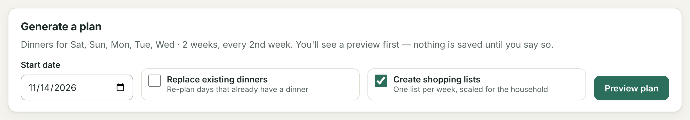
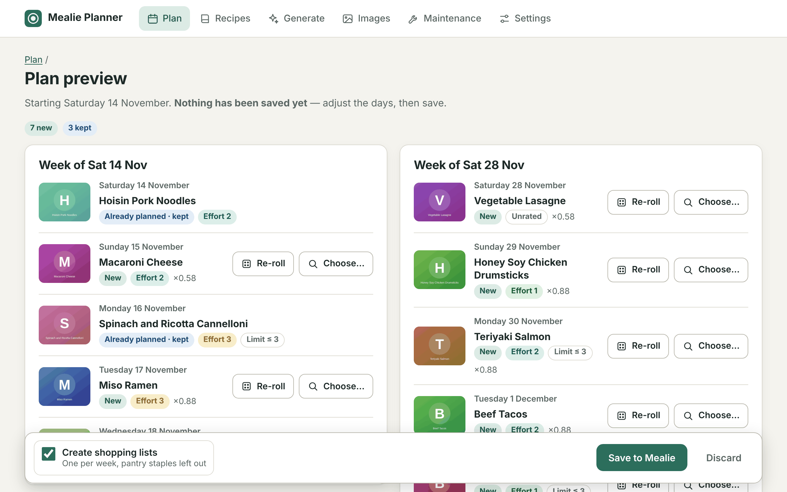
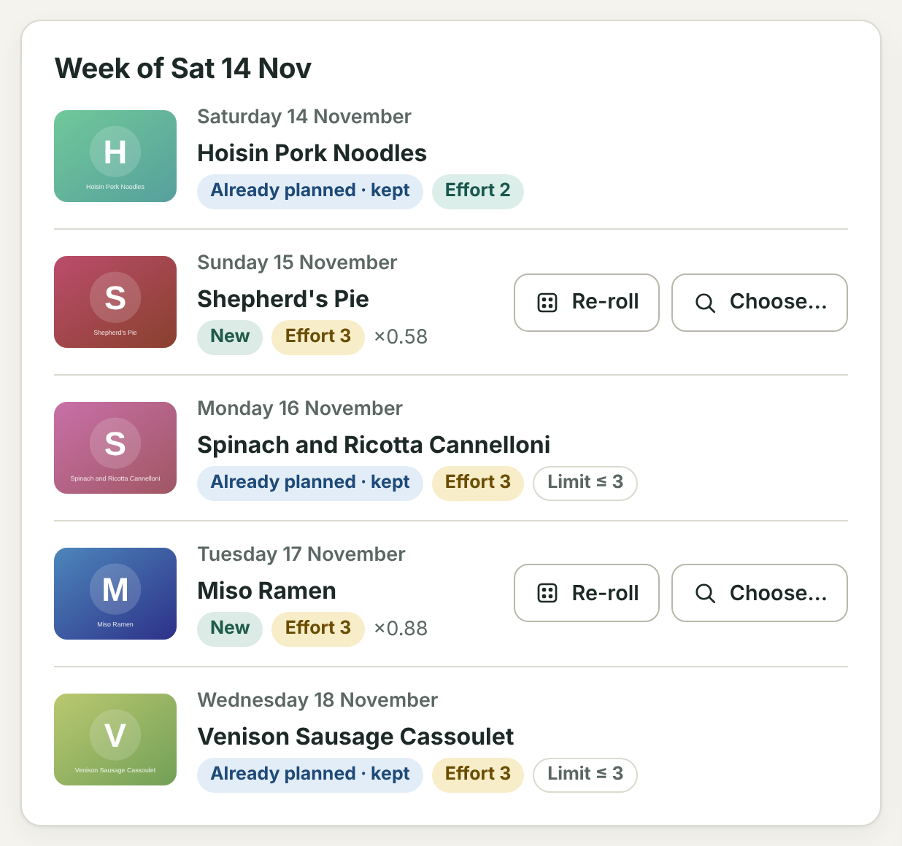
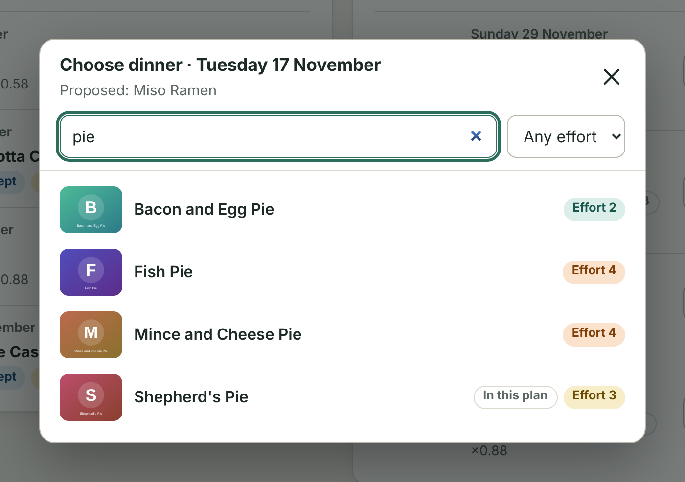
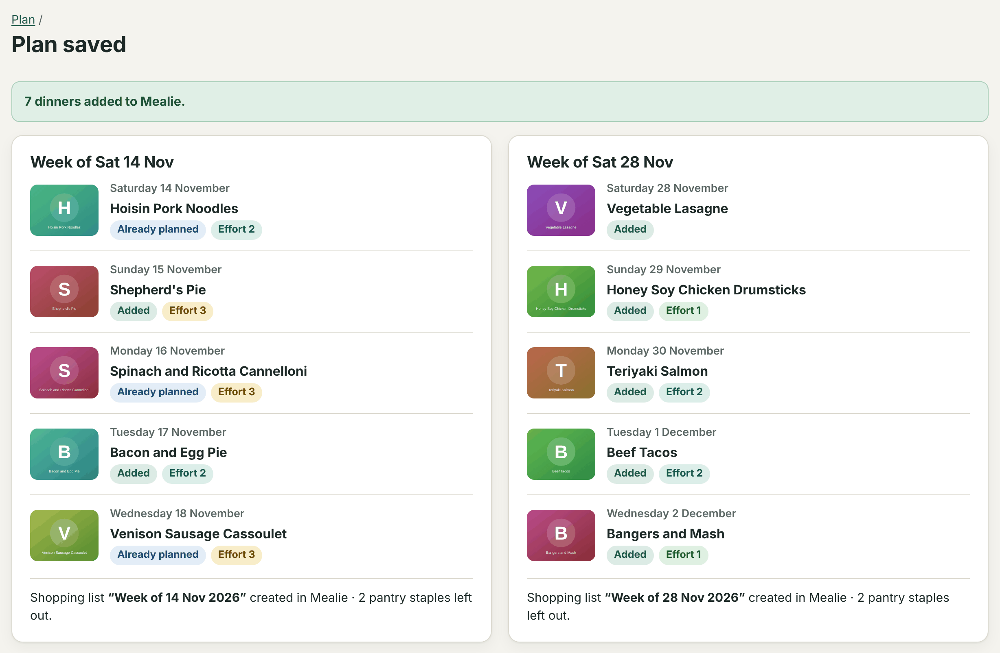
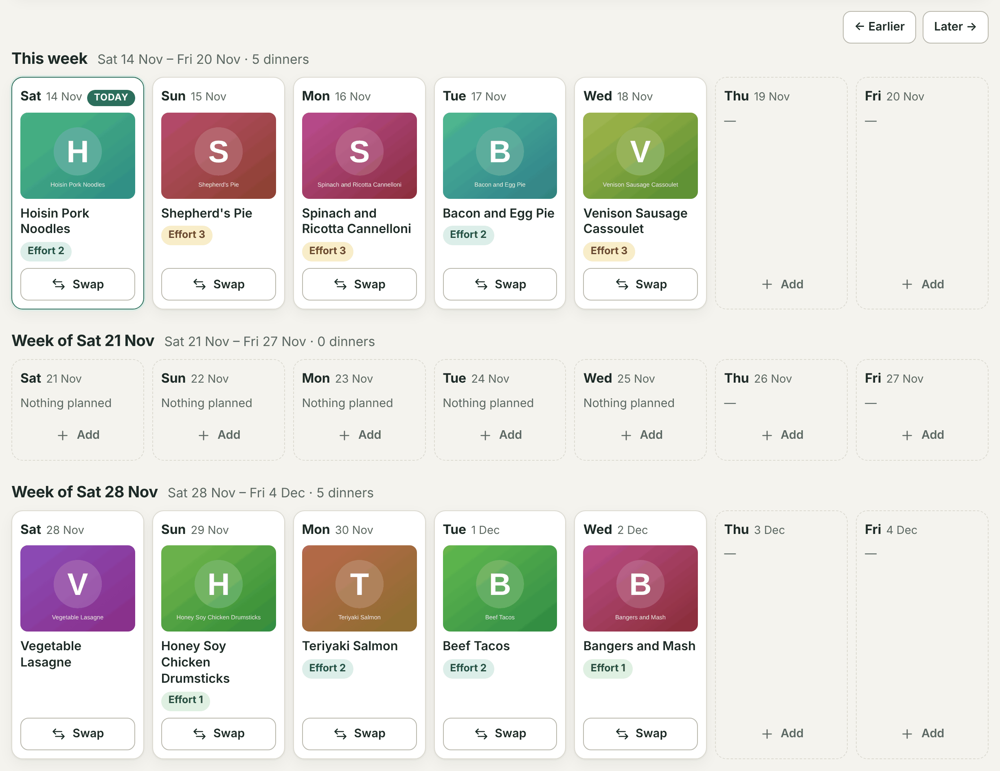
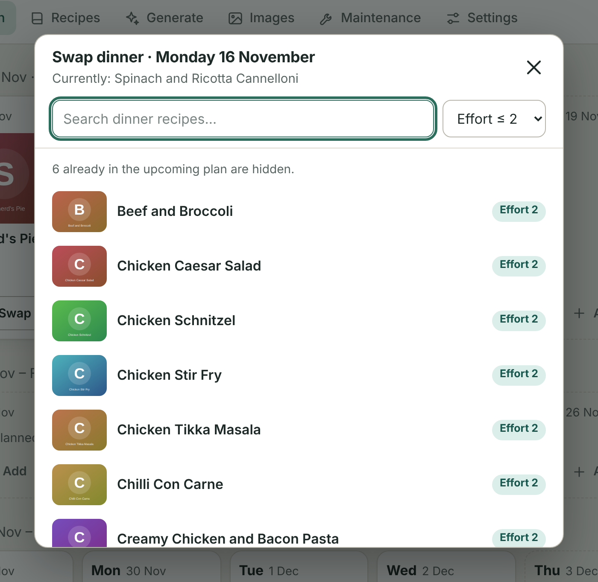

# Plan a fortnight

Generate two weeks of dinners, adjust them, save them to Mealie with shopping lists, and swap a day later.

[Back to the README](../../README.md) · Next: [Add new recipes](add-new-recipes.md)

## 1. Start a plan

Open **Plan**. The start date is already set to the next Saturday (today counts). Tick **Create shopping lists** if you want them, then click **Preview plan**.

Leave **Replace existing dinners** unticked unless you want days that already have a dinner to be re-planned.

## 2. Read the preview

Nothing is in Mealie yet. **New** days are proposals; **Already planned · kept** days were in Mealie before and are left alone. **Limit ≤ 3** marks a weekday with an effort limit, and **×0.88** is how much the recipe is scaled for your household on the shopping list.

## 3. Re-roll a day you don't fancy

Click **Re-roll** on a day to get a different random recipe for it. It follows the same rules and avoids recipes that are already in this plan. Click it again as often as you like.

## 4. Or choose a specific recipe

Click **Choose…** on a day, type part of a name, and click the recipe you want. The effort filter starts at that day's limit; set it to **Any effort** to see everything. **In this plan** marks recipes already used on another day.

## 5. Save to Mealie

Click **Save to Mealie** in the bar at the bottom of the preview. The dinners are added to Mealie's meal plan. With **Create shopping lists** ticked, each week also gets a Mealie shopping list named after its start date, with pantry staples left out. If a list with that name already exists it is replaced; the save bar warns you first.

## 6. See it on the calendar

Click **Back to the plan**. The calendar shows four weeks at a time; use **Earlier** and **Later** to move. With the default settings every second week is planned, so the week in between stays empty.

## 7. Swap a day later

Plans change. Click **Swap** on any day that is not in the past, then pick a replacement. Recipes already planned in the next six weeks are hidden. On an empty day the button says **Add** and works the same way.

Swapping changes the meal plan only. A shopping list that was already created is not updated.
