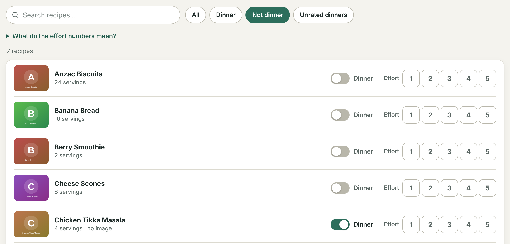
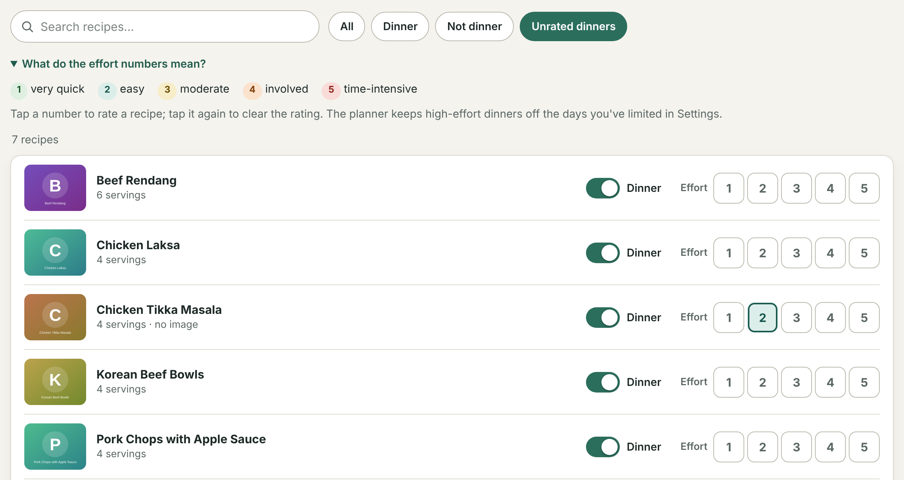
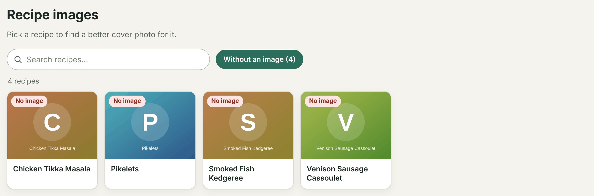
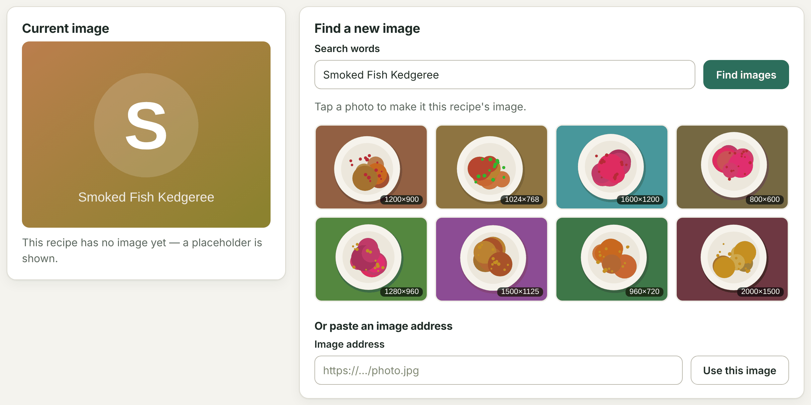
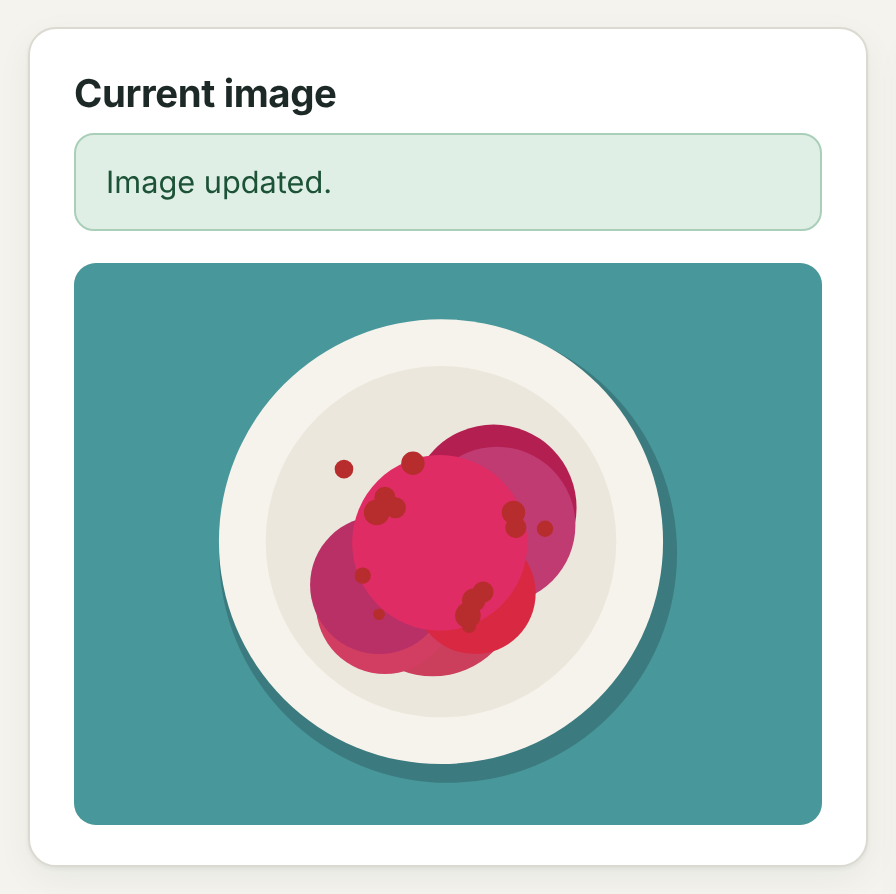
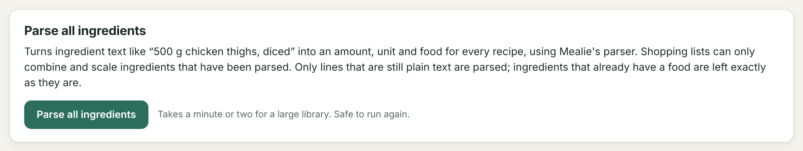
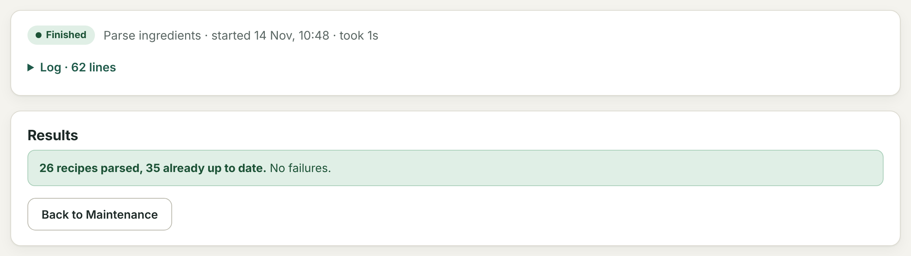

# Tidy your recipe library

Tell the planner which recipes are dinners and how much work they are, fix a cover image, and parse ingredients so shopping lists add up.

[Back to the README](../../README.md) · Previous: [Add new recipes](add-new-recipes.md) · Next: [Change the rules](change-the-rules.md)

## 1. Mark the dinners

Open **Recipes** and click **Not dinner**. Switch **Dinner** on for every recipe the planner may use. It saves at once; there is no save button. The switch adds or removes the `dinner` tag in Mealie.

## 2. Rate the effort

Click **Unrated dinners**, then click a number from 1 to 5 on each row. Click the same number again to clear it. The planner uses the rating to keep hard recipes off the weekdays you have limited in Settings; unrated recipes can land on any day.

## 3. Find recipes without a photo

Open **Images** and click **Without an image**. Click a recipe to open it. You can also search for any recipe to replace a photo that does not match.

## 4. Search for a photo

Click **Find images**. Change the search words first if the recipe name alone is too vague. If you already have a picture in mind, paste its address under **Or paste an image address** instead.

## 5. Pick one

Click a photo. It is downloaded and uploaded to Mealie as the recipe's cover, and **Current image** updates to show it.

## 6. Parse the ingredients

Open **Maintenance** and click **Parse all ingredients**. This turns text like "500 g chicken thighs, diced" into an amount, a unit and a food for every recipe. Recipes generated with Claude are parsed on import; run this for recipes you added to Mealie yourself or imported from a web address.

## 7. Check the result

When the job finishes it says how many recipes were parsed and how many needed nothing. Any that failed are listed, each with a **Retry** button. Running it again is safe.
